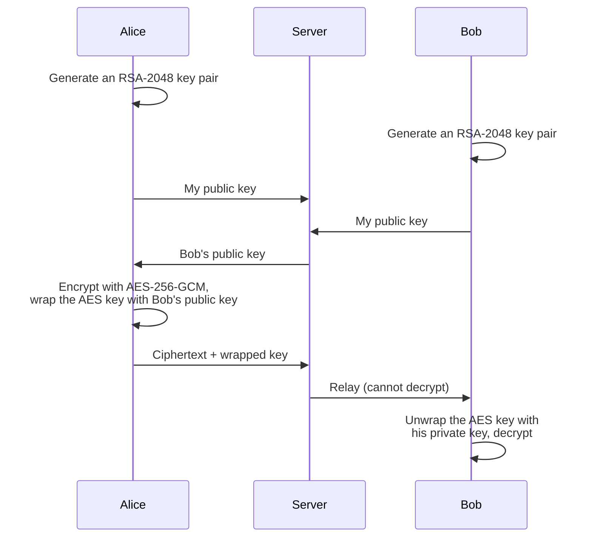

# ChifferChat

> The server passes your messages along. It never gets to read them.

An end-to-end encrypted chat in Java. Each client makes its own RSA key pair, encrypts its
messages with AES, and hands the server nothing but ciphertext and public keys.

| Version | Where | Status |
|---|---|---|
| **Desktop app**: JavaFX client, multithreaded socket server | commit [`1fa5c28`](https://github.com/Carlsmeister/java-encryption-chatapp-chifferchat/tree/1fa5c28) | ✅ Built: login, chats, group chats, E2E encryption |
| **Web app**: Spring Boot backend, React frontend | this branch, `dev` | ⏸️ Paused since February 2026: backend skeleton, no frontend yet |

## How a message travels



Private keys never leave the client. The server stores and relays public keys and ciphertext.

**Known limitation:** public keys reach the clients through the server unverified, so a
malicious server could swap them (a man-in-the-middle). Key fingerprints that users compare
would close that gap; it is on the roadmap.

## Run the desktop version

You need JDK 17 and Maven.

```bash
git clone https://github.com/Carlsmeister/java-encryption-chatapp-chifferchat.git
cd java-encryption-chatapp-chifferchat
git checkout 1fa5c28
```

1. Start the server: run `se.mau.chifferchat.server.Server` from your IDE. It listens on
   port 5090.
2. Start a client, one per user: `mvn clean javafx:run`

## Run the web backend (this branch)

```bash
cd backend
./mvnw spring-boot:run
```

It starts on port 8080 with the `dev` profile. This is the skeleton the web app grows from:
WebSocket, Spring Security with JWT, JPA with Flyway, PostgreSQL/H2 and Testcontainers are
wired in, and the encryption classes are carried over, but no endpoints exist yet. GitHub
Actions builds and tests it on every push.

## Stack

| | Desktop | Web |
|---|---|---|
| Language | Java 17 | Java 17 |
| UI | JavaFX 21, FXML | React (planned) |
| Transport | TCP sockets, thread pool | WebSocket |
| Crypto | RSA-2048, AES-256-GCM | the same classes, carried over |
| Backend | — | Spring Boot 3.2, Spring Security, JWT, JPA, Flyway, PostgreSQL/H2 |
| Tests and CI | — | Testcontainers, GitHub Actions |

## Roadmap

- [ ] REST and WebSocket endpoints in the Spring Boot backend
- [ ] React frontend
- [ ] Key fingerprints, to rule out a man-in-the-middle
